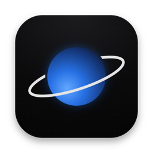
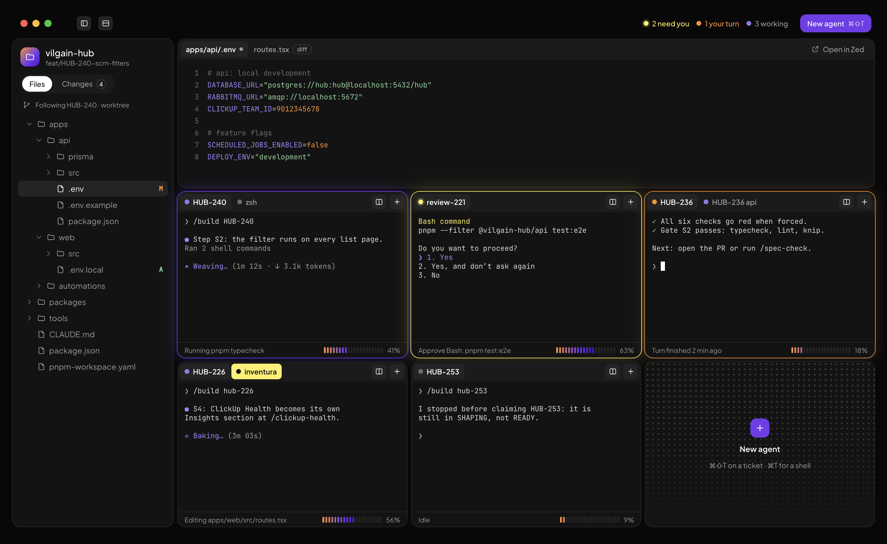
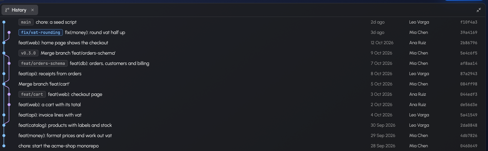
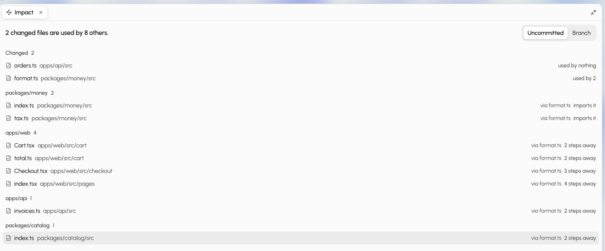
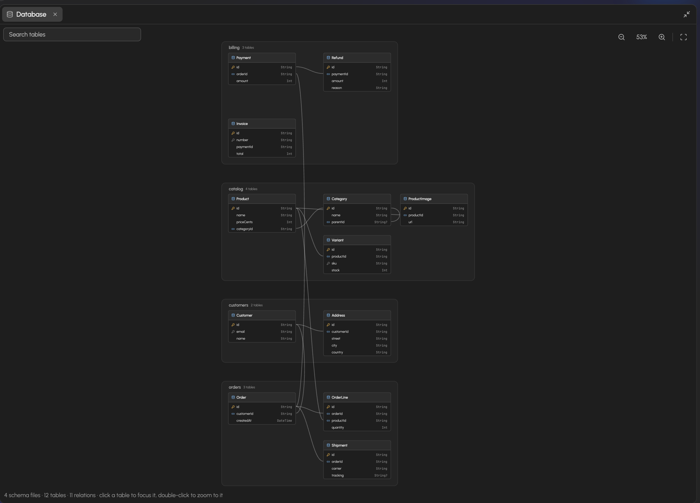
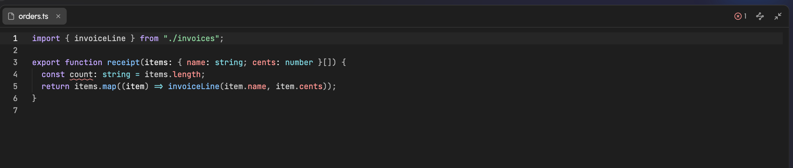

<div align="center">



# Saturn

**A native macOS workbench for running many Claude Code agents side by side.**

A grid of terminals, a light editor, a diff review, and a clear signal when an agent needs you.
Native Rust on GPUI: no browser, no Electron.

</div>



## Why

One Claude Code session is a terminal tab. Five of them are a juggling act: which one finished,
which one is waiting on a permission prompt, which one broke the build. Saturn puts them all on one
screen and tells you where to look, with the files and diffs they touch one click away.

It isn't an IDE and doesn't try to replace yours. It's the place the agents live.

## What it does

- **A grid of terminals.** Split right (⌘D) and down (⌘⇧D), or drag a tab onto a pane's edge to
  split it there. Tabs in every pane, dividers you drag, one pane maximised with ⌘⇧↩. A real
  terminal underneath (alacritty's engine), so TUIs, colours and the mouse work as they should.
- **Agents that tell you how they're doing.** Each tab shows whether its agent is working, waiting
  for you, done, or failed. A pane that needs you rings orange, one that's done rings green,
  until you type or click in it. The title bar
  counts them, ⌘⇧A jumps to the next one that needs you, macOS notifies you while Saturn is in the
  background, and a small Saturn in the menu bar shows how many are waiting even while it's hidden; its menu
  takes you to the next one.
- **Your Claude plan's limits.** The bottom of the sidebar shows what `/usage` does: the current
  session, the week, and a model's own week, with when each resets. Saturn asks Claude Code for
  them every few minutes and after an agent's turn; click to read them again.
- **dbt lineage.** In a repo with a dbt project, the workflow button in the sidebar's header draws
  its lineage graph: sources and seeds on the left, then each model past what it reads. Click a
  model to light up everything upstream and downstream of it, double-click to open its SQL. A big
  project (more than 150 nodes) shows one model at a time with what's 1, 2 or 3 steps around it:
  the one open in the editor, or one you search for, and a click moves to another. Read
  from the project's `ref()` and `source()` calls; dbt itself isn't needed.
- **Several repos in one window.** Repos sit as tabs in the title bar (⌘O adds one); agents from
  different repos share one grid, and new tabs open in the repo you've selected.
- **Files and a light editor.** ⌘P finds any file by a few letters of its name or path; ⌘⇧P
  finds any command. A file tree with git badges (what git ignores shown faint), and an editor with
  syntax highlighting for about 60 languages that saves with your project's own formatter
  (Prettier, Biome, oxfmt or rustfmt). Files an agent changes reload by themselves; if you have
  unsaved edits, Saturn asks first.
- **Language servers.** TypeScript and JavaScript, Rust, Python and Go get completions, hover, go
  to definition (⌘-click), quick fixes, Find references and Rename across files (⌘.), and errors
  underlined as you type and listed in Problems, from the server your project already uses. For
  TypeScript, Saturn installs one with a click when there's none.
- **Review what changed.** The Changes tab lists every changed file with checkboxes to stage them,
  for your uncommitted work or the whole branch, with a diff for each. History draws every branch
  as a graph, with tags, authors and dates; click a commit to see its diff.
- **See what a change reaches.** Impact follows imports (JavaScript and TypeScript with `tsconfig`
  aliases and a monorepo's own packages, Rust modules and crates, Python packages) to every file
  that depends on what changed, nearest first, grouped by folder. Click a file to see what it uses
  and what uses it.
- **A diagram of the database.** From a Prisma schema or SQL migrations: every table with its
  columns and keys, a line for each foreign key, grouped by schema file. Pinch to zoom, search,
  click a table to see what it's connected to.
- **Pull requests on the panes.** A pane whose branch has a pull request shows its number and
  state, from the `gh` CLI.
- **A status bar.** Errors and warnings, the language server, the cursor, the file's language, and
  the branch with how many commits are waiting to be pushed and pulled.
- **Follows the agent you're looking at.** Focus a pane that works in another git worktree, and the
  sidebar switches to that worktree.
- **Opens where you left off.** The window's repos and grid come back as they were, and Saturn
  offers to resume the Claude sessions that were running: the resume command is typed for you,
  never run.
- **Glass, light and dark.** The title bar and sidebar are macOS's frosted glass over your desktop;
  panes are cards on it. It follows macOS's appearance, or you pick one. Every icon button says what
  it does, and its shortcut, when you hover it.
- **Optional: tickets from ClickUp.** Connect a token and ⌘⇧N lists the tickets assigned to you,
  and ⌘⌥B opens them as a panel on the right, by status, marking the ones an agent is on, with
  filters for status, priority, due date, space, list and tag that Saturn remembers. Pick
  one, and Saturn opens a pane (in its own worktree if you like) and starts your agent on it.
  If you don't connect anything, none of this shows up.

## A closer look

|                                                                                                                                   |                                                                                                                                         |
| --------------------------------------------------------------------------------------------------------------------------------- | --------------------------------------------------------------------------------------------------------------------------------------- |
|  **History**: every branch as a graph; click a commit for its diff.   |  **Impact**: what your changes reach, nearest first.               |
|  **Database**: the schema as a diagram, grouped by file. |  **Language servers**: errors as you type, and the rest on ⌘. |

## Install

Saturn builds from source and needs macOS, [rustup](https://rustup.rs),
[pnpm](https://pnpm.io) and [Claude Code](https://claude.com/claude-code).

```sh
git clone https://github.com/itsjonasarden/saturn.git
cd saturn
pnpm install
pnpm install-app      # builds Saturn.app and puts it in /Applications
```

Then open Saturn from Spotlight and pick a folder. Run `claude` in any pane.

Rust's version is pinned in `rust-toolchain.toml`, and rustup installs it on the first build.

### Share it

`pnpm dist:dmg` builds `target/Saturn-<version>.dmg`, for Apple Silicon and Intel Macs.
Saturn isn't signed with an Apple Developer ID, so the first time someone opens it, macOS can't
check it: they click Done, then **Open Anyway** in System Settings → Privacy & Security. The disk
image carries a note that says so. They need [Claude Code](https://claude.com/claude-code) too.

Saturn updates itself with [Sparkle](https://sparkle-project.org): every hour it checks the newest
GitHub release and offers what's new (Saturn → Check for Updates… checks now). `pnpm release 0.2.0`
publishes a version: it tags it, builds the disk image, signs it with the Sparkle key in your
keychain, and puts it on GitHub with the feed.

## Shortcuts

| Keys         | Does                                                 |
| ------------ | ---------------------------------------------------- |
| ⌘P           | Go to a file, by name or path                        |
| ⌘⇧P          | Command palette: every command by name               |
| ⌘N           | New tab in the focused pane                          |
| ⌘D / ⌘⇧D     | Split right / down                                   |
| ⌘W           | Close tab                                            |
| ⌘1 … ⌘9      | Focus pane 1 to 9                                    |
| ⌘⌥ + arrows  | Move focus between panes                             |
| ⌘⇧[ / ⌘⇧]    | Previous / next tab                                  |
| ⌘⇧↩          | Maximise the focused pane                            |
| ⌘⇧A          | Jump to the next agent that needs you                |
| ⌘B / ⌘J      | Toggle the sidebar / the editor                      |
| ⌘O           | Add a repo                                           |
| ⌘S           | Save the open file                                   |
| ⌘+ / ⌘− / ⌘0 | Text in terminals and files bigger / smaller / usual |
| ⌘-click      | Go to definition                                     |
| ⌘.           | Quick fixes, Find references, Rename                 |
| ⌘,           | Settings                                             |
| ⌘⇧N          | New agent from a ticket (with ClickUp)               |
| ⌘⌥B          | Show or hide your tickets (ClickUp)                  |

Every shortcut but copy, paste and quit can be changed in Settings → Keyboard shortcuts.

## How it talks to Claude Code

Saturn doesn't change your Claude Code setup. Every shell it opens gets `SATURN_SOCKET`,
`SATURN_PANE_ID` and `CLAUDE_CODE_PLUGIN_DIRS`, so a `claude` started inside Saturn loads the small
plugin in [`plugin/`](plugin) for that session only. The plugin's hooks tell the pane what the agent
is doing (working, waiting for a permission, done, failed) and do nothing outside Saturn. Run
`claude` in any other terminal and it's exactly as before.

## Settings

Open them with ⌘, or the gear in the title bar: sections on the left, with a search across all of
them. They're stored in `~/Library/Application Support/Saturn/settings.json`.

- **General**: notifications when an agent needs you while Saturn is in the background; the menu bar
  icon with how many agents wait for you; checking for updates now.
- **Appearance**: System, Light or Dark; the text size of terminals and files; the plan usage card.
- **Editor**: format on save (with the formatter your project already uses), wrapping long lines,
  line numbers, indent guides, visible whitespace, tab width.
- **Terminal**: Option as Meta (Option+B jumps a word back in the shell) instead of typing the
  characters your keyboard layout puts on it; copy on select. Inside Claude Code, dragging selects
  in Claude itself and copies what you select; hold Shift or Option to select with Saturn instead.
  Dropping files (a screenshot, say) on a terminal types their paths, so Claude attaches them.
- **Claude**: Saturn's status line under Claude Code's prompt (model, context, the task list's
  step, the session's limit), in Saturn and in any other terminal; turning it on keeps the one you
  had, to put back. Tabs named after Claude's session (a name you type yourself always wins); sessions
  named after tickets, so `/start abc-224` renames the session to `ABC-224`, as `/rename ABC-224`
  would. Tickets mentioned in normal prompts never rename anything.
- **Keyboard shortcuts**: click one and press the keys you want; a shortcut that had them gives them
  up.
- **ClickUp** (optional): your API token, kept in the macOS Keychain, plus, for each project, the
  command a ticket starts (`claude -n {ticket}` by default) and whether it gets its own worktree.

## Develop

```sh
pnpm demo             # Saturn on a made-up project, to look around or show it off
pnpm dev              # build and run Saturn (cargo run -p saturn)
pnpm health           # format check, clippy, tests, unused deps, licences
pnpm dist             # build Saturn.app in target/bundle.noindex
```

Node is only used for commit hooks and for formatting Markdown and JSON. Commits follow
[Conventional Commits](https://www.conventionalcommits.org).

| Crate                    | What it holds                                                                |
| ------------------------ | ---------------------------------------------------------------------------- |
| `crates/saturn`          | The app: window, title bar, grid, sidebar, editor, views, settings           |
| `crates/saturn-terminal` | Shells in ptys, alacritty's engine, Claude Code's signals, the terminal view |
| `crates/saturn-core`     | Logic without UI: layout, agents, git, imports, schemas, the LSP client      |
| `crates/saturn-design`   | Design tokens compiled from [`design/tokens.json`](design/tokens.json)       |
| `crates/saturn-bridge`   | Where the plugin's hooks reach Saturn: a small HTTP server on a Unix socket  |

More reading: [the design system](docs/04-design-system.md) and [the Rust stack](docs/05-rust-stack.md).
Want to change something? [AGENTS.md](AGENTS.md) has the rules, for people and coding agents alike.

### Spikes and screenshots

`SATURN_PANES=12 SATURN_COMMAND="node scripts/tui-load.mjs 30 14" SATURN_PERF=1 cargo run -p saturn --release`
opens a busy grid and prints frame timings. With `--features capture`, `SATURN_SCREENSHOT=out.png`
saves what the window draws.

## Licence

[MIT](LICENSE). Saturn bundles [Urbanist](https://github.com/coreyhu/Urbanist) and
[JetBrains Mono](https://www.jetbrains.com/lp/mono/) (SIL Open Font Licence) a few
[Lucide](https://lucide.dev) icons (ISC), and [Sparkle](https://sparkle-project.org) (MIT) for updates.
