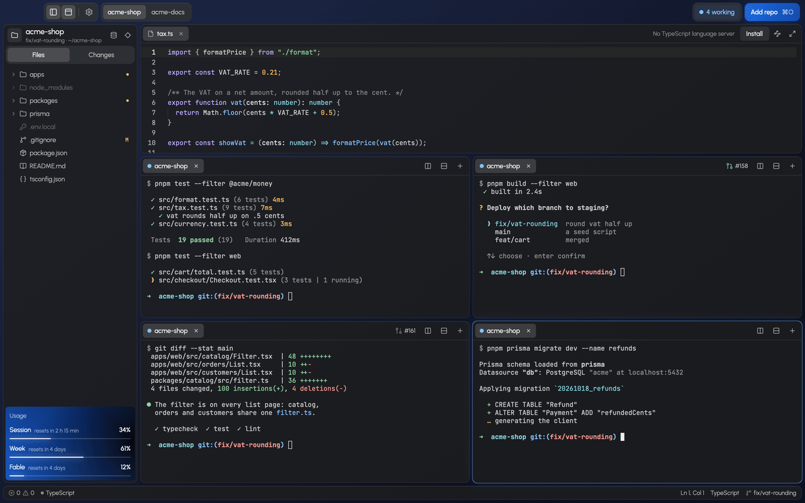

<div align="center">


# Saturn

**Run many Claude Code agents side by side, and see which one needs you.**

A native macOS workbench: a grid of terminals, a light editor, a diff review, and a clear signal
when an agent needs you.

<a href="https://github.com/itsjonasarden/saturn/releases/latest/download/Saturn.dmg"><b>Download for macOS</b></a>
·
<a href="#features">Features</a>
·
<a href="#shortcuts">Shortcuts</a>
·
<a href="#faq">FAQ</a>
·
<a href="https://github.com/itsjonasarden/saturn/releases">Releases</a>

<a href="https://github.com/itsjonasarden/saturn/releases/latest"></a>

<a href="LICENSE"></a>

</div>

<picture>
  <source media="(prefers-reduced-motion: reduce)" srcset="docs/images/saturn-window.png" />
  
</picture>

## Highlights

- **See which agent needs you.** A pane rings orange when its agent waits for you and green when
  it's done; the title bar counts them, and ⌘⇧A jumps to the next one.
- **A grid of real terminals.** Splits, tabs and drag to rearrange, on alacritty's engine.
- **Files, diffs and history beside them.** A light editor with language servers, the changes to
  review, a branch graph, and everything a change reaches.
- **Your plan's limits in view.** The session's and the week's usage at the foot of the sidebar.
- **Pull requests and tickets.** Each pane shows the pull request it works on; optional ClickUp
  tickets start agents in their own worktrees.

## Install

[Download Saturn](https://github.com/itsjonasarden/saturn/releases/latest/download/Saturn.dmg),
open the disk image and drag Saturn to Applications. It runs on macOS 13 or newer, on Apple
Silicon and Intel, and needs [Claude Code](https://claude.com/claude-code).

> [!NOTE]
> Saturn isn't notarised by Apple (it has no Apple Developer ID), so the first time you open it,
> macOS can't check it. Click **Done**, then **Open Anyway** in System Settings → Privacy &
> Security. You only do this once.

Saturn updates itself with [Sparkle](https://sparkle-project.org): every hour it checks the newest
GitHub release and offers what's new (Saturn → Check for Updates… checks now).

Then pick a folder and run `claude` in any pane.

### Build from source

You need [rustup](https://rustup.rs) and [pnpm](https://pnpm.io) as well.

```sh
git clone https://github.com/itsjonasarden/saturn.git
cd saturn
pnpm install
pnpm install-app      # builds Saturn.app and puts it in /Applications
```

Rust's version is pinned in `rust-toolchain.toml`, and rustup installs it on the first build.
`pnpm dist:dmg` builds a disk image for Apple Silicon and Intel to share, and
`pnpm release 0.2.0` publishes a version: it tags it, builds the disk image, signs it with the
Sparkle key in your keychain, and puts it on GitHub with the feed.

## Why

One Claude Code session is a terminal tab. Five of them are a juggling act: which one finished,
which one is waiting on a permission prompt, which one broke the build. Saturn puts them all on one
screen and tells you where to look, with the files and diffs they touch one click away.

It isn't an IDE and doesn't try to replace yours. It's the place the agents live.

## Features

### Agents

Each tab shows whether its agent is working, waiting for you, done or failed.

- A pane that needs you rings **orange**, one that's done rings **green**, until you type or click
  in it.
- A pane whose agent isn't in the usual permission mode says which (Plan mode, Accepts edits, Auto
  mode, Doesn't ask), and warns in amber when it skips permissions altogether.
- The title bar counts them, and ⌘⇧A jumps to the next one that needs you. Click a count for what
  each waits for: a permission with the command or file it's for, a question, a finished turn with
  the start of its last words, a failure. Allow or deny a permission right there (Saturn presses the
  key in the pane), or go to the pane.
- **Send to several agents** (⌘⇧P): one message, typed into every pane you pick. Panes with an agent
  are picked to begin with; a pane with only a shell starts Claude with it, and a busy one (a server,
  a build) is left alone.
- **Best of N** (⌘⇧P): one task given to two to four agents at once, each in a worktree of its own
  (branches `<task>-try-1`, `-try-2`…). **Compare attempts** lays them side by side: the files each
  changed with their lines, its commits, and whether its agent is still at it. Keep one, and the
  others' panes close and their worktrees are archived (Worktrees can restore them).
- **Search sessions** (⌘⇧P): every Claude Code session on this Mac, newest first, found by what you
  asked in it, its title, its folder or its branch. Pick one to resume it in a new pane in its
  folder, or to go to the pane it's open in.
- **Routines** (⌘⇧P): agents on a schedule, every day, on weekdays or every few hours. While Saturn
  is open it starts each one on time in a pane named after it, with its prompt, in its folder. Every
  run is listed; one whose time passed while Saturn was closed shows as missed, with Run now, and one
  that ran can be resumed. Kept in `routines.json` beside the settings.
- **Agent teams**: a pane whose Claude session leads a team (Claude Code's agent teams) shows a
  Team chip: how many are in it, how far its tasks are, and unread messages. It opens the members,
  the shared task list with who has each task, and the messages they've sent each other.
- macOS notifies you while Saturn is in the background, and a small Saturn in the menu bar shows how
  many are waiting. The moon in the title bar (Focus) holds notifications while you concentrate;
  stopping it gives one that says what happened meanwhile.
- Your Claude plan's limits at the foot of the sidebar: the session, the week, and a model's own
  week, with when each resets.
  At 80% and 95% of a limit, a notification says so and when it resets. Each pane shows roughly how
  much of the 5-hour limit its agent used (`≈18% of 5h`): its part of what all the panes' sessions
  used, read from their transcripts; hover for the tokens.
- Saturn opens where you left off and offers to resume the Claude sessions that were running (the
  command is typed for you, never run).

### Terminals

- Split right (⌘D) or down (⌘⇧D), or drag a tab onto a pane's edge to split it there. Tabs in every
  pane, one pane maximised with ⌘⇧↩. Panes share the space evenly whenever one opens or closes; drag a
  divider to change that, or double-click it to even out its two panes.
- A real terminal underneath (alacritty's engine), so TUIs, colours and the mouse work as they should.
- Drop a file, a screenshot say, on a terminal to type its path, so Claude attaches it. Pasting works
  the same: copied files (from Finder) and copied images (a screenshot copied to the clipboard) paste as
  paths Claude attaches.
- ⌘-click a link to open it, a pull request Claude links as `#123` too.
- Each pane shows the servers its agent runs, named after their app and port (`web :5173`); click one
  to open it. The repo's Docker Compose services (`postgres :5432`) sit in the bar at the bottom.
- Several repos in one window, as tabs in the title bar (the + after them, or ⌘O, adds one). Their agents share one grid.
- Focus a pane that works in another git worktree, and the sidebar follows it there.
- Worktrees (⌘⇧P): every worktree of the repo with its branch, last commit, pull request and whether
  its work is merged (squash merges too). The finished ones, with nothing uncommitted, no open pull
  request and nothing running in them, go with one click. One you're not working on now can be
  archived: its branch and uncommitted work are kept, the folder goes, and Restore brings it back
  where it was (so `claude --resume` finds its sessions) and sets it up again.
- Worktrees share the main checkout's `.env` files: each one's is a link to main's, so a value added
  in any worktree is in all of them. `CLAUDE.local.md` and `.claude/settings.local.json` (the commands
  you allowed Claude for good) are shared the same way; Claude shares its own memory already. A
  worktree's own, different file is left alone.
- New agent (⌘⇧N): name the work (`fix-login`) and Saturn makes a worktree for it on a branch of that
  name, sets it up with the [worktree recipe](#worktree-recipe), and starts your agent there. The
  palette's "Start the app" opens a tab per server.

### Files and editor

- ⌘P finds any file by a few letters of its name or path; ⌘⇧P finds any command.
- A file tree with an icon for each kind of file and git badges; what git ignores is shown faint.
- Syntax highlighting for about 60 languages, saved with your project's own formatter (Prettier,
  Biome, oxfmt or rustfmt).
- Files an agent changes reload by themselves; if you have unsaved edits, Saturn asks first.
- Language servers for TypeScript and JavaScript, Rust, Python and Go: completions, hover, go to
  definition (⌘-click), quick fixes, Find references and Rename (⌘.), and errors as you type. For
  TypeScript, Saturn installs one with a click when there's none.


### Review

- **Changes**: every changed file, for your uncommitted work or the whole branch, with a diff for
  each and checkboxes to stage them.
- **Comments for the agent**: the + beside a line in the diff (or a selection of lines) takes a
  comment, as in a pull request review. "Send to the agent" gives them all to the agent working
  there in one message, each with its file, lines and code; with no agent there, a new pane starts
  Claude on them. They only ever go to a pane running an agent, never to a bare shell.
- **One change at a time**: click a line in the review to pick its change, then stage just that one,
  or revert it, leaving the file's other changes as they are. A revert can be undone.
- **Compare with anything**: "Compare with a branch or commit" (⌘⇧P, or the button under Changes)
  lists the branches, tags and recent commits; pick one to review everything that differs from it,
  uncommitted work too. Comments and single changes work there as well.
- **Undo a turn**: Saturn saves a worktree's files when its agent starts a turn and when it ends it
  (in git, under its own `refs/saturn/`, touching no branch and running no hook). The pane's ↶ then
  puts back exactly the files that turn changed, however it changed them (shell commands too), and
  leaves the rest alone; ↷ redoes it. If one of them changed since, nothing is put back.
- **Pictures of the app** (⌘⇧P): the pages of a pane's running server, drawn at a desktop's size
  and a phone's by a Chromium browser already on your Mac (Chrome, Brave, Edge, Chromium or Arc;
  invisibly, with a profile of its own). Each set is kept with its branch and time, for the whole
  repo, so two lie side by side: the default branch against an agent's, or before a turn against
  after. "Open folder" for a pull request or a ticket. "Preview the app" shows a pane's running page in the editor panel, drawn
  again every few seconds while it's open, at desktop or phone size: a picture to watch, since a
  browser engine doesn't live in Saturn; "Open in your browser" is a click away.
- **What the agent is told** (⌘⇧P): for the focused pane's folder, everything Claude Code gives
  its agent, found as it finds it: instruction files (`CLAUDE.md`, `AGENTS.md`, `CLAUDE.local.md`,
  yours), rules and the files they're for, skills, commands, subagents, hooks and MCP servers. Long
  instruction files get a word, and anything said in more than one file comes first, so the copies
  can't drift apart. Each opens in the editor.
- **Teach the repo** (⌘⇧P): the pane's recent prompts, corrections ("no, don't…", "always…") first;
  pick one, say it as a lesson, and add it under `## Lessons` in `AGENTS.md`, `CLAUDE.md` or your
  own `CLAUDE.local.md`, where it shows in Changes to review, or ask the agent to word it. A mistake
  corrected once stays corrected for every session after.
- **Overlaps**: when two panes' worktrees of one repo change the same files, both panes say so
  (hover for which files and where), while it's still easy to merge one first or split the work.
- **What was asked**: each file in the review says what you asked Claude Code that changed it (the
  latest prompt; hover for the ones before), read from its session transcripts on your Mac. Edits
  made through the shell can't be traced, so those files say nothing.
- **History**: every branch as a graph, with tags, authors and dates; click a commit for its diff.
- **Impact**: every file that depends on what changed, nearest first. It follows imports in
  JavaScript and TypeScript (with `tsconfig` aliases and a monorepo's packages), Rust and Python.
- **Pull requests**: each pane shows the one it works on, with its state, from the `gh` CLI: an open
  one whose title or branch names the pane's ticket (`ABC-123`), else the last one linked in it, else
  its branch's, else one that only mentions the ticket (a subtask's). Its
  checks show beside it (✓ passed, ● running, ✕ failed; hover for which), and when they fail, the
  wrench hands them to the pane's agent with where to read why. Open review threads count beside it
  (💬 2): click to hand them to the agent too, each with its file, line and conversation, and any
  request for changes. When the repo deploys pull requests (GitHub deployments: Vercel, Netlify, a
  workflow), ↗ Preview opens this one's. "Edit the pull request's description" (⌘⇧P) opens it as it is on GitHub, or the
  repo's template when it's empty, names the template's sections it leaves empty or out, and saves
  it back; or hands the writing to the agent, with the template to follow.
- **Status bar**: errors and warnings, the cursor, the language, and the branch with how many
  commits wait to be pushed and pulled.

|  |  |
| :----------------------------------------------------------: | :-------------------------------------------------------------------: |
|                         **History**                          |                              **Impact**                               |

### Data

- **Database**: a Prisma schema or SQL migrations drawn as a diagram, every table with its columns
  and keys and a line for each foreign key. Pinch to zoom, search, click a table to see what it's
  connected to.
- **dbt lineage**: sources and seeds on the left, then each model past what it reads. Click a model
  to light up what's upstream and downstream, double-click to open its SQL. A big project shows one
  model at a time with what's 1, 2 or 3 steps around it. dbt itself isn't needed.


### Tickets (optional)

Connect a ClickUp token, and New agent (⌘⇧N) also searches the tickets assigned to you; ⌘⌥B shows
them as a panel on the right, with filters for status, priority, due date, space, list and tag. Pick
one, and Saturn opens a pane (in its own worktree if you like) and starts your agent on it. Without
a tracker, New agent starts work you name, and the rest doesn't show up.

### Looks

Panes, the sidebar and the editor are cards on Saturn's own blue backdrop: deep navy in dark mode,
soft periwinkle in light. It follows macOS's appearance, or you pick one. Terminals tell programs
which it is when they ask, so Claude Code's "Auto" theme (`/theme`) matches, and switches with it.

## Shortcuts

| Keys         | Does                                                 |
| ------------ | ---------------------------------------------------- |
| ⌘P           | Go to a file, by name or path                        |
| ⌘⇧P          | Command palette: every command by name               |
| ⌘N           | New tab in the focused pane                          |
| ⌘D / ⌘⇧D     | Split right / down                                   |
| ⌘W           | Close tab                                            |
| ⌘1 … ⌘9      | Focus pane 1 to 9                                    |
| ⌘⌥ + arrows  | Move focus between panes                             |
| ⌘⇧[ / ⌘⇧]    | Previous / next tab                                  |
| ⌘⇧↩          | Maximise the focused pane                            |
| ⌘⇧A          | Jump to the next agent that needs you                |
| ⌘B / ⌘J      | Toggle the sidebar / the editor                      |
| ⌘O           | Add a repo                                           |
| ⌘S           | Save the open file                                   |
| ⌘+ / ⌘− / ⌘0 | Text in terminals and files bigger / smaller / usual |
| ⌘-click      | Go to definition; open a link in a terminal          |
| ⌘.           | Quick fixes, Find references, Rename                 |
| ⌘,           | Settings                                             |
| ⌘⇧N          | New agent, in a worktree of its own                  |
| ⌘⌥B          | Show or hide your tickets (ClickUp)                  |

Every shortcut but copy, paste and quit can be changed in Settings → Keyboard shortcuts.

## How it talks to Claude Code

Saturn doesn't change your Claude Code setup. Every shell it opens gets `SATURN_SOCKET`,
`SATURN_PANE_ID` and `CLAUDE_CODE_PLUGIN_DIRS`, so a `claude` started inside Saturn loads the small
plugin in [`plugin/`](plugin) for that session only. The plugin's hooks tell the pane what the agent
is doing (working, waiting for a permission, done, failed) and do nothing outside Saturn. Run
`claude` in any other terminal and it's exactly as before.

## Worktree recipe

A fresh worktree has the code but nothing git ignores: no dependencies, no builds. With no setup
at all, Saturn guesses the steps from the repo's own files: the lockfile says how to install
(`pnpm-lock.yaml`, `yarn.lock`, `package-lock.json`, `bun.lock`, `uv.lock`, `poetry.lock`,
`Gemfile.lock`, `composer.lock`, `mix.lock`, `go.sum`), and `dev` scripts (at the top, or one per app
in `apps/`, `services/`, `packages/`) or `bin/dev` say how to start it.

To change the steps, "Create worktree recipe" in the palette saves the guess to
`.saturn/worktree.json`, to adjust and commit with the repo:

```json
{
  "setup": ["pnpm install", "pnpm --filter @acme/shared build"],
  "run": { "api": "pnpm --filter api dev", "web": "pnpm --filter web dev" },
  "cleanup": "docker compose down",
  "checks": { "lint": "pnpm lint", "test": "pnpm test" }
}
```

- `setup` runs in a worktree Saturn makes for a ticket, before the agent starts (and the agent starts
  only if it worked). "Set up this worktree" in the palette (⌘⇧P) runs it again, or in a worktree made
  some other way.
- `run` names the commands that start the app. "Start the app" opens a tab for each, named after it.
- `cleanup` runs in a worktree before Worktrees removes it (stopping its containers, say).
- `checks` names commands that check the work (`"lint": "pnpm lint"`, `"test": "pnpm test"`; guessed
  from `package.json` scripts or Cargo without a recipe). "Run a check" (⌘⇧P) runs one, or all, in
  the background: the pane shows each as it runs and how it went, a click opens its whole log, and a
  failed one goes to the agent as a short summary with the log's path. Output that says no tests
  ran counts as a failure, whatever the exit code.

Files git ignores that worktrees should still get (local config, certificates) go in
`.worktreeinclude`, written like `.gitignore`, as for `claude --worktree`: Saturn copies them from the
main checkout into a worktree it makes, and "Set up this worktree" fills in any that are missing.

Each checkout also gets its own block of ten ports, the same every time: `SATURN_PORT` in its
terminals is the first (42000, 42010…), and the sidebar shows the block. Use it where two worktrees'
servers would otherwise clash; shell arithmetic gives the rest:

```json
"run": {
  "api": "PORT=$((SATURN_PORT + 1)) pnpm --filter api dev",
  "web": "API_URL=http://localhost:$((SATURN_PORT + 1)) pnpm --filter web dev --port $SATURN_PORT"
}
```

A list of steps runs one after another and stops at the first that fails. Every field is optional. A
branch made before the recipe existed uses the main checkout's. Steps Saturn guessed say so in the
pane before they run.

## Settings

Open them with ⌘, or the gear in the title bar: sections on the left, with a search across all of
them. They're stored in `~/Library/Application Support/Saturn/settings.json`.

- **General**: notifications when an agent needs you while Saturn is in the background; the menu bar
  icon with how many agents wait for you; sharing `.env` and Claude's local files with worktrees; checking for updates now.
- **Appearance**: System, Light or Dark; the text size of terminals and files; the plan usage card.
- **Editor**: format on save (with the formatter your project already uses), wrapping long lines,
  line numbers, indent guides, visible whitespace, tab width.
- **Terminal**: Option as Meta (Option+B jumps a word back in the shell) instead of typing the
  characters your keyboard layout puts on it; copy on select. Inside Claude Code, dragging selects
  in Claude itself and copies what you select; hold Shift or Option to select with Saturn instead.
  Dropping files (a screenshot, say) on a terminal types their paths, so Claude attaches them.
- **Claude**: Saturn's status line under Claude Code's prompt (model, context, the task list's
  step, the session's limit), in Saturn and in any other terminal; turning it on keeps the one you
  had, to put back. Tabs named after Claude's session (a name you type yourself always wins); sessions
  named after tickets, so `/start abc-224` renames the session to `ABC-224`, as `/rename ABC-224`
  would. Tickets mentioned in normal prompts never rename anything.
- **Keyboard shortcuts**: click one and press the keys you want; a shortcut that had them gives them
  up.
- **ClickUp** (optional): your API token, kept in a file only you can read, plus, for each project, the
  command a ticket starts (`claude -n {ticket}` by default; `claude -n {ticket} "/start {ticket}"`
  sends the agent a first message, so it starts working at once) and whether it gets its own
  worktree.

## FAQ

**Is Saturn an IDE?** No. It's where the agents run, with enough of an editor to read and fix what
they touch. Keep your own editor for the rest.

**Does it change my Claude Code setup?** No. Saturn loads its small plugin only for the `claude`
sessions started inside it (see [How it talks to Claude Code](#how-it-talks-to-claude-code)). The
status line in Settings is the one thing that reaches other terminals, and only if you turn it on.

**Does it work with other agents?** Any program runs in its terminals. The signals (working,
needs you, done) come from Claude Code's hooks, so only Claude Code reports how it's doing.

**What leaves my Mac?** Saturn has no server and collects nothing. It asks GitHub for new
versions and, through your own `gh`, for pull requests; Claude Code for your plan's usage; and
ClickUp only if you connect a token, which stays in a file only you can read.

**Why does macOS warn me the first time?** Saturn isn't notarised, because that needs a paid Apple
Developer ID. It's built from this repo, and updates are signed, so an installed Saturn only accepts
versions published here.

**Is it free?** Yes, under the MIT licence. Claude Code needs your own Claude plan.

**Windows or Linux?** No, Saturn is made for macOS.

## Develop

```sh
pnpm demo             # Saturn on a made-up project, to look around or show it off
pnpm dev              # build, sign and run Saturn from the code
pnpm health           # format check, clippy, tests, unused deps, licences
pnpm dist             # build Saturn.app in target/bundle.noindex
```

Node is only used for commit hooks and for formatting Markdown and JSON. Commits follow
[Conventional Commits](https://www.conventionalcommits.org).

| Crate                    | What it holds                                                                |
| ------------------------ | ---------------------------------------------------------------------------- |
| `crates/saturn`          | The app: window, title bar, grid, sidebar, editor, views, settings           |
| `crates/saturn-terminal` | Shells in ptys, alacritty's engine, Claude Code's signals, the terminal view |
| `crates/saturn-core`     | Logic without UI: layout, agents, git, imports, schemas, the LSP client      |
| `crates/saturn-design`   | Design tokens compiled from [`design/tokens.json`](design/tokens.json)       |
| `crates/saturn-bridge`   | Where the plugin's hooks reach Saturn: a small HTTP server on a Unix socket  |

More reading: [the design system](docs/04-design-system.md) and [the Rust stack](docs/05-rust-stack.md).
Want to change something? [AGENTS.md](AGENTS.md) has the rules, for people and coding agents alike.

### Spikes and screenshots

`SATURN_PANES=12 SATURN_COMMAND="node scripts/tui-load.mjs 30 14" SATURN_PERF=1 cargo run -p saturn --release`
opens a busy grid and prints frame timings. With `--features capture`, `SATURN_SCREENSHOT=out.png`
saves what the window draws.

## Licence

[MIT](LICENSE). Saturn bundles [Urbanist](https://github.com/coreyhu/Urbanist) and
[JetBrains Mono](https://www.jetbrains.com/lp/mono/) (SIL Open Font Licence) a few
[Lucide](https://lucide.dev) icons (ISC), and [Sparkle](https://sparkle-project.org) (MIT) for updates.
